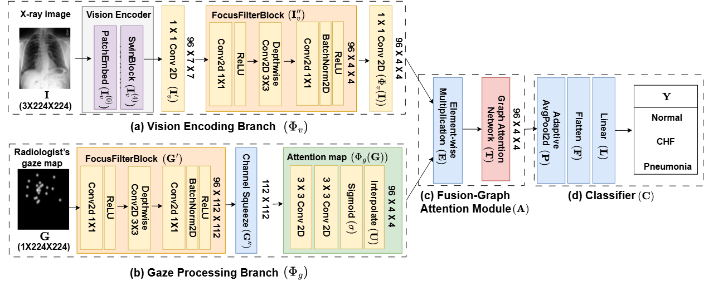
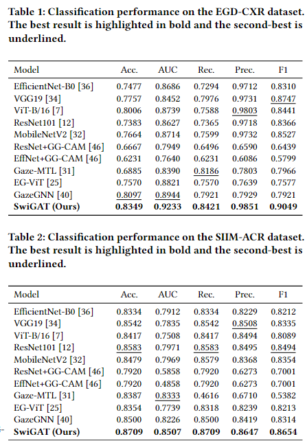

# SwiGAT

**SwiGAT: A Gaze-Guided Swin Transformer with Graph-Based Relational Reasoning for Chest X-ray Classification**

## Overview

Chest X-ray classification remains challenging because subtle radiographic patterns and overlapping anatomical structures can obscure diagnostically relevant evidence. Moreover, disease-related findings may be distributed across spatially separated regions.

SwiGAT is a **gaze-guided graph-based framework** that incorporates radiologist gaze maps as continuous spatial priors and performs relational reasoning among regional visual features.

SwiGAT consists of three main components:

- **Dual-Branch Feature Refinement**  
  Independently refines the X-ray and gaze representations using branch-specific instances of the proposed FocusFilterBlock (FFB).

- **Gaze-Guided Feature Weighting**  
  Uses the refined gaze map to weight the refined X-ray map through element-wise multiplication, producing gaze-modulated region-level features.

- **Graph-Based Relational Reasoning**  
  Constructs a fully connected graph over the regional features and employs a graph attention network (GAT) to model long-range inter-regional dependencies among spatially distant but diagnostically related regions.

## Architecture



## Data Preparation

SwiGAT is evaluated on two gaze-annotated chest X-ray datasets:

- **EGD-CXR**  
  A gaze-annotated subset of MIMIC-CXR containing Normal, Congestive Heart Failure (CHF), and Pneumonia cases. We use 976 images for training and 107 images for testing.

- **SIIM-ACR**  
  A binary chest X-ray classification dataset for distinguishing pneumothorax from normal cases. We use 1,000 images for training and 250 images for testing.

The repository does not redistribute chest X-ray images or radiologist gaze data. Please obtain the datasets from their respective official sources and comply with their licenses and data-use requirements.

## Training and Evaluation

`main.py` is the single entry point for both training and evaluation.

### EGD-CXR

```bash
python main.py --config configs/egd_cxr.yaml
```

### SIIM-ACR

```bash
python main.py --config configs/siim_acr.yaml
```

The configuration files specify the dataset path, number of classes, training hyperparameters, and output directory.

To evaluate a trained checkpoint without retraining:

```bash
python main.py --config configs/egd_cxr.yaml --mode test --checkpoint checkpoints/egd_cxr_best.pt
```

Replace the configuration and checkpoint paths as needed for SIIM-ACR.

## Results

SwiGAT achieves the highest overall performance among the compared image-based and gaze-guided methods on both datasets.

 

The reported results are averaged over three runs with different random seeds.


